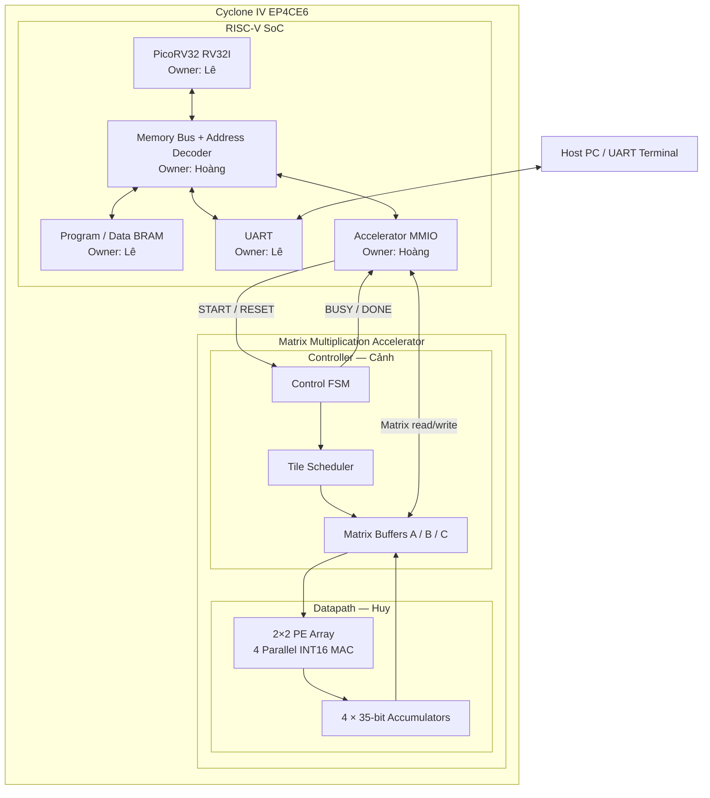
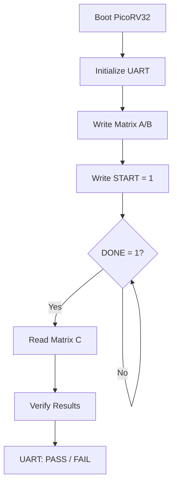
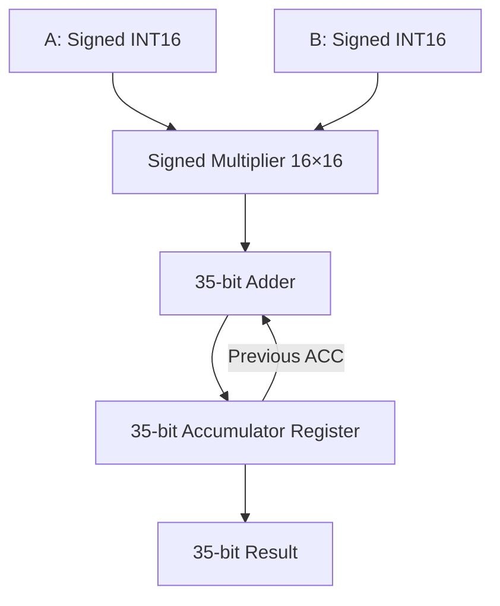
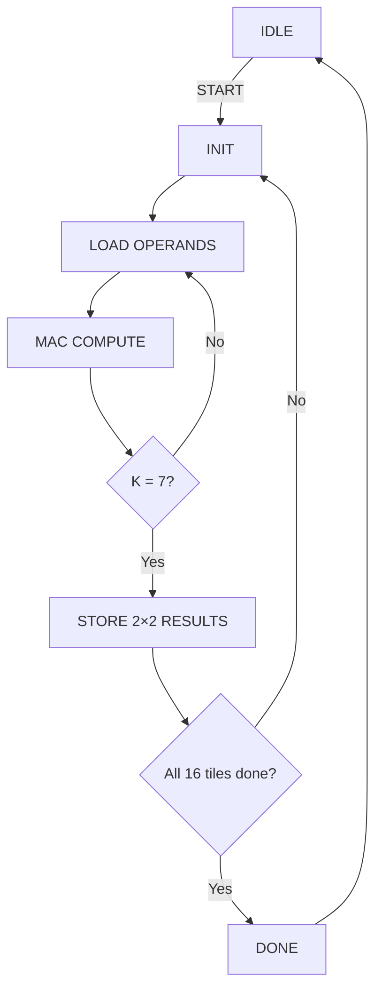
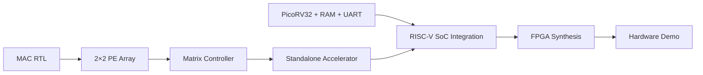

# System Architecture — RISC-V Matrix Accelerator

**Project:** RISC-V-Based 8×8 Matrix Multiplication Accelerator  
**FPGA:** Intel Cyclone IV EP4CE6  
**Scope:** Giai đoạn 1 — Matrix Accelerator và Giai đoạn 2 — RISC-V SoC Integration

## 1. Tổng quan kiến trúc

Hệ thống gồm hai thành phần chính:

- **RISC-V SoC:** PicoRV32 thực thi firmware C, quản lý bộ nhớ và điều khiển accelerator.
- **Matrix Accelerator:** Thực hiện phép nhân hai ma trận 8×8 signed INT16 bằng 2×2 PE/MAC Array.

Các module giao tiếp qua memory-mapped interface.



## 2. Kiến trúc RISC-V SoC

**Owner: Hoàng & Lê**

RISC-V SoC sử dụng PicoRV32 RV32I với các thành phần tối thiểu:

| Module | Chức năng | Owner |
|---|---|---|
| PicoRV32 | Thực thi firmware C | Lê |
| Program/Data BRAM | Lưu chương trình và dữ liệu CPU | Lê |
| Address Decoder | Giải mã địa chỉ CPU | Hoàng |
| Accelerator MMIO | Giao tiếp CPU với accelerator | Hoàng |
| UART | Xuất kết quả và debug | Lê |
| SoC Top | Kết nối các module | Hoàng |

### Memory Map dự kiến

| Address | Peripheral | Chức năng |
|---|---|---|
| `0x00000000` | RAM | Firmware và dữ liệu |
| `0x10000000` | UART | Truyền dữ liệu |
| `0x20000000` | Accelerator | Thanh ghi điều khiển |
| `0x20000100` | Matrix A | 64 phần tử INT16 |
| `0x20000200` | Matrix B | 64 phần tử INT16 |
| `0x20000300` | Matrix C | 64 phần tử INT35 |

Mỗi phần tử ma trận được ánh xạ thành một word 32-bit đối với A/B và hai word 32-bit đối với C. Phần tử C được mở rộng dấu thành 64-bit khi CPU đọc. Các vùng địa chỉ trên là đề xuất ban đầu và cần được thống nhất trước khi viết RTL.

### Luồng điều khiển CPU



## 3. Kiến trúc Matrix Accelerator

**Owner: Huy & Cảnh**

### 3.1. Thông số

| Parameter | Value |
|---|---|
| Matrix dimensions | 8×8 |
| Input precision | Signed INT16 |
| Product precision | Signed INT32 |
| Accumulator precision | Signed INT35 |
| PE Array | 2×2 |
| Parallel MAC | 4 |
| DSP dự kiến | 4 |
| Clock mục tiêu | 50 MHz |

### 3.2. PE/MAC Datapath

**Owner: Huy**

Mỗi PE thực hiện:

\[
ACC \leftarrow ACC + A_{i,k}\times B_{k,j}
\]



Một PE bao gồm:

- 1 signed multiplier 16×16.
- 1 signed accumulator 35-bit.
- Tín hiệu `clear`, `enable`.
- Output signed 35-bit.

Bốn PE được tổ chức thành mảng 2×2, tính song song bốn phần tử đầu ra.

### 3.3. Matrix Controller

**Owner: Cảnh**

Controller thực hiện:

1. Nhận tín hiệu START.
2. Chọn tile 2×2 cần xử lý.
3. Reset accumulator của bốn PE.
4. Cấp dữ liệu A/B theo chỉ số K.
5. Thực hiện 8 bước MAC.
6. Ghi bốn kết quả vào buffer C.
7. Chuyển sang tile tiếp theo.
8. Phát DONE sau khi hoàn thành 16 tile.



### 3.4. Matrix Buffer

**Owner: Cảnh**

| Buffer | Số phần tử | Dung lượng |
|---|---:|---:|
| Matrix A | 64 × 16-bit | 1,024 bit |
| Matrix B | 64 × 16-bit | 1,024 bit |
| Matrix C | 64 × 35-bit | 2,240 bit |
| **Total** | | **4,288 bit** |

Buffer có thể sử dụng M9K BRAM hoặc registers tùy kết quả synthesis.

Bộ điều khiển phải bảo đảm đủ băng thông để cấp bốn cặp toán hạng cho PE array. Có thể sử dụng thanh ghi đệm hoặc banking để tái sử dụng dữ liệu A/B.

## 4. Dataflow và Tiling

Ma trận 8×8 được chia thành 16 tile đầu ra, mỗi tile có kích thước 2×2.

```text
Matrix C (8×8)

+-----+-----+-----+-----+
| T00 | T01 | T02 | T03 |
+-----+-----+-----+-----+
| T10 | T11 | T12 | T13 |
+-----+-----+-----+-----+
| T20 | T21 | T22 | T23 |
+-----+-----+-----+-----+
| T30 | T31 | T32 | T33 |
+-----+-----+-----+-----+

Each tile = 2×2 output elements
Each tile = 8 MAC iterations
Total tiles = 16
```

Với mỗi tile:

- Hai phần tử A từ hai hàng được tái sử dụng theo chiều ngang.
- Hai phần tử B từ hai cột được tái sử dụng theo chiều dọc.
- Bốn PE tích lũy kết quả trong 8 vòng K.
- Sau khi hoàn tất, bốn kết quả được ghi vào Matrix C.

**Latency lý tưởng:**

\[
16\text{ tiles}\times8\text{ cycles}=128\text{ cycles}
\]

Con số này chưa bao gồm load/store, BRAM access latency, pipeline và FSM overhead.

## 5. Interface giữa các module

| Interface | Tín hiệu chính | Owner |
|---|---|---|
| CPU → Bus | `mem_valid`, `mem_addr`, `mem_wdata`, `mem_wstrb` | Lê / Hoàng |
| Bus → CPU | `mem_ready`, `mem_rdata` | Hoàng |
| MMIO → Controller | `start`, `reset` | Hoàng / Cảnh |
| Controller → MMIO | `busy`, `done` | Cảnh |
| Controller → PE | `a_data`, `b_data`, `mac_en`, `acc_clear` | Cảnh / Huy |
| PE → Controller | `result[0:3]` | Huy |
| MMIO ↔ Buffer | `addr`, `wdata`, `rdata`, `write_en` | Hoàng / Cảnh |

**Quy tắc:** Tất cả tín hiệu điều khiển và dữ liệu phải được đồng bộ với clock hệ thống. Việc đọc/ghi BRAM phải tuân theo độ trễ thực tế của memory implementation.

## 6. Phân công phát triển

| Thành viên | Module | Deliverable |
|---|---|---|
| **Huy** | MAC + PE Array | `mac.v`, `pe_array.v`, testbench |
| **Cảnh** | FSM + Tiling + Buffer | `matrix_controller.v`, `matrix_buffer.v`, testbench |
| **Hoàng** | Bus + MMIO + SoC Top | `accelerator_mmio.v`, `soc_top.v` |
| **Lê** | PicoRV32 + UART + Firmware | Quartus CPU project, `main.c`, golden model |

### Thứ tự tích hợp



## 7. Verification Strategy

| Test | Nội dung | Expected |
|---|---|---|
| MAC Test | Signed multiplication và accumulation | PASS |
| PE Array Test | Bốn MAC chạy song song | PASS |
| Matrix Test | Nhân hai ma trận 8×8 | Khớp golden model |
| MMIO Test | CPU đọc/ghi register | PASS |
| SoC Test | Firmware điều khiển accelerator | PASS |
| FPGA Test | Chạy trên EP4CE6 | PASS |
| Performance | Đo latency, DSP, LE, M9K | Có báo cáo |

Các trường hợp kiểm thử quan trọng:

- Ma trận toàn số 0.
- Identity matrix.
- Giá trị âm và dương.
- Giá trị biên INT16.
- Ma trận ngẫu nhiên.
- Kiểm tra accumulator không bị overflow.

## 8. Ràng buộc thiết kế

- Không sử dụng 64 PE song song trên EP4CE6.
- Ưu tiên 2×2 PE với 4 MAC.
- Sử dụng RV32I tối giản, không bật hardware multiplier của CPU.
- Tận dụng M9K BRAM để giảm logic.
- Không thêm DMA, cache hoặc peripheral phức tạp trong hai tuần đầu.
- Kiểm tra tài nguyên bằng Quartus ngay khi có module đầu tiên.
- Nếu vượt tài nguyên, giảm xuống 1–2 MAC.
- Mục tiêu ưu tiên là correctness và demo end-to-end trước khi tối ưu hiệu năng.

## 9. Kết quả cuối cùng

Sau hai tuần, hệ thống cần thực hiện được:

```text
RISC-V Firmware
      |
      v
Write Matrix A/B
      |
      v
Start Accelerator
      |
      v
2×2 PE Array Computes C = A × B
      |
      v
Read Matrix C
      |
      v
Verify Results
      |
      v
UART: PASS / FAIL
```

**Hướng phát triển tiếp theo:** Mở rộng MAC datapath từ INT16 sang INT8, bổ sung Bias/ReLU/Requantization để hỗ trợ Fully Connected Layer và triển khai mô hình TinyML trên EP4CE6.
