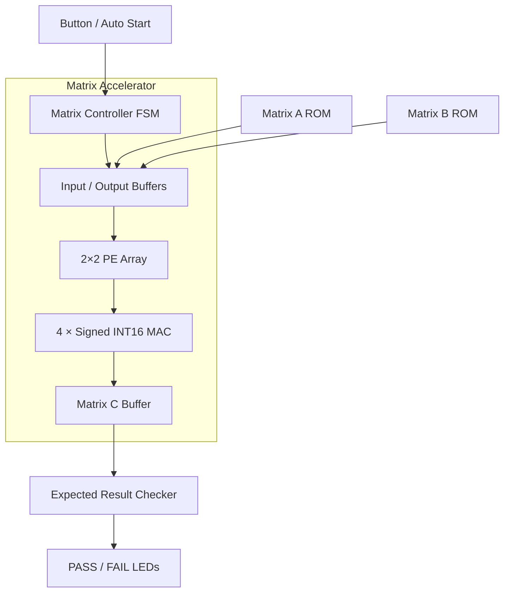
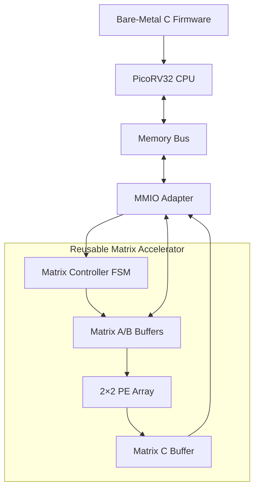
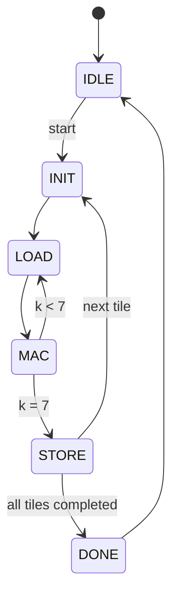

# FPGA Matrix Multiplication Accelerator — Development Plan

**Project:** Design and Implementation of an 8×8 Matrix Multiplication Accelerator on FPGA

**FPGA Board:** Intel/Altera Cyclone IV EP4CE6  
**Development Language:** Verilog HDL  
**Team:** Huy, Cảnh, Hoàng, Lê  
**Main Timeline:** 2 Weeks  
**Future Extensions:** PicoRV32 SoC, TinyML Inference

---

## 1. Project Objectives

### 1.1 Main Objective — W1 to W2

Design and implement a hardware accelerator capable of multiplying two signed INT16 matrices of size 8×8.

The accelerator uses:

- FSM-based controller.
- 2×2 Processing Element (PE) Array.
- Four parallel Multiply-Accumulate (MAC) units.
- ROM/RAM for input and output matrices.
- FPGA hardware verification.

**Expected result:** A working matrix multiplication accelerator on Cyclone IV EP4CE6 without requiring a CPU.

### 1.2 Optional Objectives

Only continue with these objectives if the main accelerator works successfully.

**Phase 2 — PicoRV32 Integration**

- Integrate PicoRV32 as a RISC-V softcore CPU.
- Connect the accelerator through Memory-Mapped I/O (MMIO).
- Write bare-metal C firmware to control the accelerator.
- Benchmark CPU-only matrix multiplication against hardware acceleration.

**Phase 3 — TinyML Inference**

- Train a small neural network model on a PC.
- Quantize and export model weights.
- Use the accelerator to execute Fully Connected Layers.
- Demonstrate handwritten digit classification.

### Project Priorities

| Priority | Feature | Required |
|---|---|---|
| P0 | Signed INT16 MAC | Yes |
| P0 | 2×2 PE Array | Yes |
| P0 | Matrix Controller FSM | Yes |
| P0 | 8×8 Matrix Multiplication | Yes |
| P0 | Simulation and Golden Model | Yes |
| P0 | FPGA Hardware Demo | Yes |
| P1 | UART Communication | Optional |
| P2 | PicoRV32 Integration | Optional |
| P3 | TinyML Model Inference | Optional |

**Project success does not depend on PicoRV32 or TinyML integration.**

---

## 2. System Architecture

### 2.1 Phase 1 — Standalone FSM Accelerator



**Operation:**

1. Store matrices A and B in ROM.
2. Trigger START.
3. FSM reads matrix elements.
4. PE Array performs multiplication and accumulation.
5. Store results in Matrix C Buffer.
6. Compare all 64 output elements against expected results.
7. Display PASS or FAIL on FPGA LEDs.

### 2.2 Phase 2 — PicoRV32 Integration



**Important design rule:** PicoRV32 does not replace the Matrix Controller FSM.

The CPU only:

1. Writes input matrices.
2. Sends START.
3. Waits for DONE.
4. Reads output results.

The original accelerator core remains reusable.

---

## 3. Matrix Accelerator Specification

| Parameter | Specification |
|---|---|
| Matrix A | 8×8 signed INT16 |
| Matrix B | 8×8 signed INT16 |
| Matrix C | 8×8 signed INT35 |
| PE Array | 2×2 |
| Parallel MAC Units | 4 |
| Multiplication | Signed 16×16 |
| Accumulator | Signed 35-bit |
| Controller | FSM |
| Dataflow | Output-stationary |
| Processing Method | Tiled matrix multiplication |
| Target FPGA | Cyclone IV EP4CE6 |

### 3.1 Matrix Multiplication

The accelerator computes:

\[
C_{i,j}=\sum_{k=0}^{7}A_{i,k}\times B_{k,j}
\]

Each PE calculates one output element.

The 2×2 PE Array processes four output elements per tile.

- Output matrix: 8×8.
- Number of output tiles: 16.
- MAC steps per tile: 8.
- Total scalar MAC operations: 512.
- Ideal MAC processing cycles: 128.

**Note:** Actual latency includes memory access, accumulator initialization, FSM transitions, and result storage.

### 3.2 FSM States



### 3.3 Memory Considerations

The PE Array requires two A operands and two B operands per MAC step.

The implementation must support this access pattern through:

- Memory banking; or
- Operand preloading into registers; or
- Additional LOAD cycles.

A single ordinary dual-port memory must not be assumed to provide all four operands simultaneously.

### 3.4 Reusable Accelerator Interface

Design the accelerator independently of the input source.

Recommended control signals:

| Signal | Direction | Description |
|---|---|---|
| `clk` | Input | System clock |
| `rst_n` | Input | Active-low reset |
| `start` | Input | Start computation |
| `busy` | Output | Accelerator is running |
| `done` | Output | Computation completed |

Also define a separate input/output buffer access interface for reading and writing A, B, and C.

Do not hard-code ROM or LED logic inside the accelerator core.

---

## 4. Week 1 — RTL Development and Simulation

**Goal:** Complete the accelerator RTL and verify correct 8×8 matrix multiplication in simulation.

| Day | Task | Owner | Deliverable |
|---|---|---|---|
| D1 | Architecture design and project setup | All | Architecture, repository |
| D1–D2 | Signed INT16 MAC | Huy | `mac.v` |
| D2–D4 | 2×2 PE Array | Huy | `pe_array.v` |
| D2–D5 | FSM and tile scheduling | Cảnh | `matrix_controller.v` |
| D3–D5 | Matrix ROM and buffers | Cảnh | `matrix_memory.v` |
| D1–D5 | Python golden model and testbench | Lê | `golden_model.py`, tests |
| D1–D3 | Quartus setup and FPGA LED Blink | Hoàng | Board bring-up |
| D5–D7 | RTL integration and simulation | All | Full accelerator simulation |

### Week 1 Test Cases

| Test | Input | Expected Result |
|---|---|---|
| TC01 | Zero Matrix | All outputs equal zero |
| TC02 | Identity Matrix | C = B |
| TC03 | Constant Matrix | A=2, B=3, C=48 |
| TC04 | Signed Matrix | Correct negative and positive results |
| TC05 | INT16 Boundary | Correct 35-bit accumulation |
| TC06 | Random Matrix | Matches Python golden model |

### Week 1 Acceptance Criteria

- [ ] MAC simulation PASS.
- [ ] PE Array simulation PASS.
- [ ] FSM processes all 16 tiles.
- [ ] All 64 output elements match Python.
- [ ] Signed arithmetic and boundary tests PASS.
- [ ] Initial Quartus synthesis fits the target FPGA.
- [ ] Module interfaces are ready for integration.

**W1 Milestone:** Functional 8×8 Matrix Accelerator in RTL simulation.

---

## 5. Week 2 — FPGA Implementation and Hardware Verification

**Goal:** Run the accelerator on the Cyclone IV EP4CE6 board.

| Day | Task | Owner | Deliverable |
|---|---|---|---|
| D8–D9 | Quartus top-level integration | Hoàng | `standalone_top.v` |
| D9–D10 | Synthesis, timing and resource analysis | Hoàng + Huy | Quartus reports |
| D10–D11 | FPGA programming and hardware debugging | Hoàng + Cảnh | Running design |
| D11–D12 | Output comparator and LED indicators | Lê + Cảnh | PASS/FAIL demo |
| D12–D13 | Additional hardware test vectors | All | Verified hardware |
| D14 | Final demonstration and documentation | All | MVP deliverables |

### Hardware Demonstration

1. Load two matrices from ROM.
2. Start multiplication.
3. Wait until DONE.
4. Compare 64 output elements with expected results.
5. Display PASS/FAIL through LEDs.

**UART is not mandatory during W2.**

UART can be implemented if there is enough remaining development time.

### Hardware Resource Report

Record the following:

| Metric | Result |
|---|---|
| Logic Elements | TBD |
| Embedded Multipliers | TBD |
| M9K Memory Blocks | TBD |
| Fmax | TBD |
| Clock Frequency | TBD |
| Computation Latency | TBD |
| Hardware Verification | PASS / FAIL |

### Week 2 Acceptance Criteria

- [ ] FPGA bitstream successfully programmed.
- [ ] START/DONE works on hardware.
- [ ] Matrix multiplication completes without errors.
- [ ] All 64 outputs pass hardware verification.
- [ ] Resource utilization recorded.
- [ ] Timing requirements satisfied.
- [ ] README, simulation results and demo completed.

**W2 Milestone:** Working standalone FPGA Matrix Accelerator.

---

## 6. Week 3 — PicoRV32 Integration (Optional)

**Prerequisite:** W2 successfully completed and sufficient FPGA resources remain.

### Objectives

- Integrate PicoRV32.
- Add program/data RAM.
- Implement MMIO access to the accelerator.
- Control matrix multiplication using C firmware.
- Read results through MMIO.
- Send results through UART.
- Compare CPU-only and accelerated execution.

### Example Memory Map

| Address | Register / Buffer |
|---|---|
| `0x20000000` | CONTROL |
| `0x20000004` | STATUS |
| `0x20000100` | MATRIX_A |
| `0x20000200` | MATRIX_B |
| `0x20000300` | MATRIX_C |

These addresses are proposed, not provided by PicoRV32.

The 35-bit signed output elements require two 32-bit accesses per element when stored in 64-bit slots.

### Firmware Operation

```c
matrix_multiply(A, B, C);
```

Internally:

1. Write A and B through MMIO.
2. Set START.
3. Wait for DONE.
4. Read Matrix C.
5. Verify results.

### Acceptance Criteria

- [ ] PicoRV32 boots and executes bare-metal firmware.
- [ ] CPU can write/read accelerator registers.
- [ ] CPU starts accelerator successfully.
- [ ] CPU reads all 64 correct output elements.
- [ ] UART displays results.
- [ ] Resource usage remains within FPGA limits.

**W3 Milestone:** PicoRV32-controlled Matrix Accelerator.

---

## 7. Week 4+ — TinyML Model Inference (Optional)

### Selected Model

**MLP — Handwritten Digit Classification**

Dataset: scikit-learn Digits.

Architecture:

```text
Input Image (8×8)
       |
       v
64 Input Features
       |
       v
Fully Connected: 64 → 8
       |
       v
ReLU
       |
       v
Fully Connected: 8 → 10
       |
       v
Argmax
       |
       v
Prediction: Digit 0–9
```

### Model Characteristics

| Parameter | Value |
|---|---|
| Input | 64 pixels |
| Hidden Layer | 8 neurons |
| Output | 10 classes |
| Weights | 592 |
| Biases | 18 |
| MAC Operations | 592 per inference |
| Initial Quantization Target | INT16 |

### Implementation Steps

1. Train the model on PC.
2. Validate prediction accuracy.
3. Quantize weights and activations.
4. Export weights into FPGA-accessible memory.
5. Split FC layers into accelerator-compatible operations.
6. Use PicoRV32 firmware to manage the layers.
7. Perform bias addition, ReLU, scaling and argmax.
8. Send an 8×8 image through UART.
9. Return the predicted digit.

### Important Architecture Note

The 8×8 accelerator cannot directly execute the entire `64→8→10` network in one operation.

The firmware must divide larger dot products into multiple chunks and accumulate their partial results.

The accumulation width and fixed-point scaling must be checked separately for full FC layers.

**W4 Milestone:** TinyML inference using the FPGA Matrix Accelerator.

---

## 8. Team Responsibilities

| Member | W1 | W2 | Optional W3–W4 |
|---|---|---|---|
| Huy | MAC, PE Array | PE optimization, timing | Accelerator performance |
| Cảnh | FSM, tiling, buffers | Hardware FSM debugging | MMIO controller |
| Hoàng | Quartus, top-level, board setup | Hardware integration | PicoRV32 and SoC |
| Lê | Golden model, verification | Hardware tests, results | Firmware, TinyML |

### Collaboration Rules

- Each member owns their main modules.
- Define interfaces before integration.
- Every RTL module must have a testbench.
- Integration occurs regularly rather than only at the end of the week.
- Do not modify the accelerator core solely to accommodate ROM, UART or PicoRV32.
- Any optimization must preserve functional correctness.

---

## 9. Proposed Repository Structure

```text
fpga-matrix-accelerator/
├── rtl/
│   ├── core/
│   │   ├── mac.v
│   │   ├── pe_array.v
│   │   ├── matrix_controller.v
│   │   ├── matrix_buffer.v
│   │   └── matrix_accelerator.v
│   │
│   ├── standalone/
│   │   └── standalone_top.v
│   │
│   └── soc/
│       ├── matrix_mmio.v
│       └── soc_top.v
│
├── tb/
│   ├── tb_mac.v
│   ├── tb_pe_array.v
│   └── tb_matrix_accelerator.v
│
├── memory/
│   ├── matrix_a.mif
│   ├── matrix_b.mif
│   └── expected_c.mif
│
├── scripts/
│   └── golden_model.py
│
├── firmware/
├── model/
├── quartus/
├── docs/
└── README.md
```

The `soc/`, `firmware/` and `model/` directories are optional and can remain empty until later phases.

---

## 10. Development Decisions

### After W1

| Condition | Action |
|---|---|
| RTL simulation PASS | Continue W2 |
| RTL simulation FAIL | Fix functional bugs |
| Excessive FPGA resource usage | Reduce PE count or simplify memory |

### After W2

| Condition | Action |
|---|---|
| Hardware PASS and resources available | Consider PicoRV32 |
| Hardware PASS but limited resources | Keep standalone accelerator as final product |
| Hardware not stable | Continue hardware debugging |
| PicoRV32 integration not feasible | Consider FSM-based TinyML as a separate extension |

### After W3

| Condition | Action |
|---|---|
| CPU + Accelerator PASS | Begin model integration |
| CPU works but accelerator integration fails | Debug MMIO and handshake |
| Resources exceeded | Reduce MAC count, RAM or CPU features |

**Never sacrifice the stable W2 implementation just to complete an optional extension.**

---

## 11. Final Deliverables

### Mandatory — End of W2

- [ ] RTL source code.
- [ ] Functional FSM-based Matrix Accelerator.
- [ ] Signed INT16 multiplication with correct accumulation.
- [ ] Complete testbench.
- [ ] Python golden model.
- [ ] Quartus project.
- [ ] FPGA hardware demonstration.
- [ ] Resource and timing report.
- [ ] Architecture diagram.
- [ ] Project README.

### Optional — Later Phases

- [ ] PicoRV32-based SoC.
- [ ] MMIO accelerator interface.
- [ ] Bare-metal C firmware.
- [ ] UART communication.
- [ ] TinyML model weights.
- [ ] MLP inference demonstration.
- [ ] CPU versus accelerator benchmark.

---

## 12. References

### FPGA and Matrix Acceleration

- [Matrix Multiplication Accelerator](https://github.com/GuanShiChen/matrix-multiplication-accelerator)
- [Systolic Array Matrix Multiplier](https://github.com/debtanu09/systolic_array_matrix_multiplier)
- [INT8 Systolic MatMul FPGA](https://github.com/bgordeev/int8-systolic-matmul-fpga)
- [Cyclone IV Device Handbook](https://www.intel.com/content/www/us/en/docs/programmable/683151/current/overview.html)

### RISC-V

- [PicoRV32](https://github.com/YosysHQ/picorv32)
- [PicoSoC Example](https://github.com/YosysHQ/picorv32/tree/main/picosoc)

### Verification and TinyML

- [NumPy Matrix Multiplication](https://numpy.org/doc/stable/reference/generated/numpy.matmul.html)
- [scikit-learn Digits Dataset](https://scikit-learn.org/stable/modules/generated/sklearn.datasets.load_digits.html)
- [Nandland UART](https://github.com/nandland/UART)
- [PySerial](https://pyserial.readthedocs.io/en/latest/)

---

## 13. Project Summary

**Main Goal:** Build and verify an 8×8 signed INT16 Matrix Accelerator on Cyclone IV EP4CE6 using an FSM controller and a 2×2 PE Array.

**W1:** RTL development, PE Array, FSM and simulation.

**W2:** FPGA hardware implementation, testing and demonstration.

**W3 (Optional):** PicoRV32 integration through MMIO.

**W4+ (Optional):** TinyML inference using an MLP model.

### Core Development Principle

> Build the Matrix Accelerator first. Keep its computation engine independent of the control source. Start with FSM, integrate PicoRV32 only when the hardware is stable, and port a TinyML model when the SoC is ready.

**Minimum successful outcome:** A working standalone FPGA Matrix Accelerator.

**Extended outcome:** A RISC-V SoC with a hardware Matrix Accelerator capable of supporting TinyML inference.
