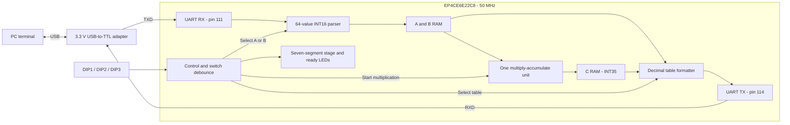
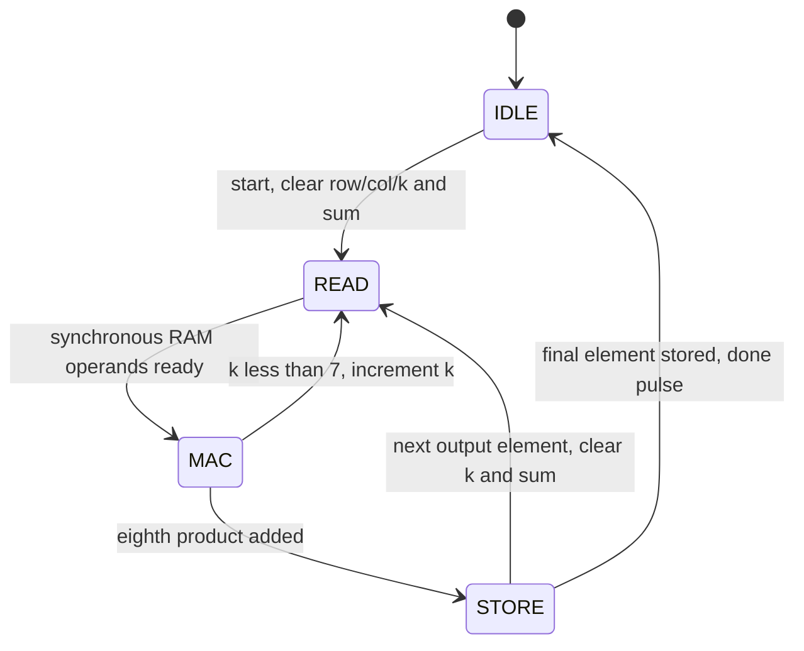

# UART-controlled 8×8 matrix multiplier

Enter two **8×8 signed integer matrices** over a USB-to-TTL UART adapter, then print **C = A × B** in your terminal. A conventional row-by-column multiplier computes the result on the Cyclone IV **EP4CE6E22C8** at 50 MHz.

## System overview



The formatter reads the stored matrices and sends eight rows over UART, so the PC can inspect A, B and C. The LEDs indicate completed data; the seven-segment digit indicates the selected stage.

## Controls and status display

Use the **red DIP switch block**, with only one switch ON at a time. Leave pushbuttons S1–S4 released, since they share the DIP inputs.

| DIP selection | DIG1 shows | UART operation |
| --- | --- | --- |
| All OFF | Blank | Idle; retain completed A and B |
| **1 ON** | **1** | Prompt `A:64`, then receive 64 values for matrix A |
| **2 ON** | **2** | Prompt `B:64`, then receive 64 values for matrix B |
| **3 ON** | **3** | Compute and print all 64 values of C, followed by `DONE` |
| 4 | — | Unused |

The displayed number identifies the selected stage and remains visible until the stage changes. UART messages report readiness, completion and errors. Reset clears the matrix-ready flags, blanks the display, and sends `READY`.

The separate user LEDs show which matrices are ready:

| LED | Turns ON when | Turns OFF when |
| --- | --- | --- |
| **LED1** | All 64 values of **A** are stored | Starting a replacement A or resetting |
| **LED2** | All 64 values of **B** are stored | Starting a replacement B or resetting |
| **LED3** | **C** has finished computing and is ready to print | Starting a replacement A/B, starting another multiplication, or resetting |
| LED4 | Unused; always OFF | — |

These indicators accumulate: after A and B are loaded, LED1 and LED2 are both ON; after multiplication, all three are ON. They remain ON with the DIP switches OFF. LED3 is cleared whenever an input matrix is replaced, so it cannot indicate a result for stale inputs. All LEDs are OFF after reset. The LEDs are active low internally.

Selections are debounced for 10 ms. If multiple switches are ON, priority is **3 > 2 > 1**. Turning a higher-priority switch OFF can select a lower switch that is still ON and start a new input transaction; using one switch at a time avoids this.

## 1. Connect your USB-to-TTL adapter

Confirm that the adapter's **TXD signal uses 3.3 V logic** before connecting it. A pin marked `3V3` may only be a power output; check the adapter's signal-level setting. A 5 V TXD needs level shifting.

| Adapter pin | Board connection | Purpose |
| --- | --- | --- |
| **RXD** | Header pad **114**, P1 contact **7** (`uart_tx`) | Receive prompts and C on the PC |
| **TXD** | Header pad **111**, P1 contact **4** (`gpio`) | Send matrix values to the FPGA |
| **GND** | Board **GND**, e.g. P1 contact 1 or 2 | Common signal ground |
| **VCC / 5V / 3V3** | **Leave disconnected** | Power the board separately |

**111** and **114** are FPGA pin numbers printed beside the expansion header, not header contact numbers. Check the pad labels and supplied schematic for your PCB revision. Wire colors vary between adapters.

The [FPGA-UART-TX reference](../../FPGA-UART-TX/README.md) demonstrates transmission on pin 114. This project receives on spare pin 111. **Keep adapter TXD off pin 115:** the onboard MAX3232 already drives that pin. The DB9 connector is unused by this build, and no MAX3232 modification is required.

With board power and the adapter USB disconnected, attach the three signal wires and connect the USB-Blaster to the **JTAG** header. Set all DIP switches OFF. Power the board through its USB power connector or a suitable 5 V adapter, then connect the UART adapter to the PC. The board's own USB connector supplies power; the separate UART adapter provides the COM port.

According to the board manual, pressing the red power selector selects USB power and releasing it selects the DC adapter; verify this on your revision. Disconnect power and the UART adapter before rewiring. Connect/remove the JTAG cable while the board is powered off.

## 2. Compile and program

Copy this complete directory to the computer running Quartus, including the updated baud generator and new matrix core. Open [my_uart_top.qpf](my_uart_top.qpf), with device **EP4CE6E22C8** and top-level entity **my_uart_top**.

The synthesis file list in [my_uart_top.qsf](my_uart_top.qsf) must contain all five files as `SYSTEMVERILOG_FILE` assignments:

```text
my_uart_top.sv
my_uart_rx.sv
my_uart_tx.sv
speed_select.sv
matrix_multiply.sv
```

Run **Processing > Start Compilation**. In **Tools > Programmer**, select USB-Blaster, use **JTAG** mode, load the newly built `output_files/my_uart_top.sof`, select **Program/Configure**, and click **Start**. The board must be powered during programming. The `.sof` configuration is volatile and must be programmed again after a power cycle.

Command-line compilation, when Quartus is on your PATH:

```bash
cd /home/hoangb/workspace/matrix_multiply_accelerate/main_software_rtl
quartus_sh --flow compile my_uart_top
```

The project still sources the full [cyclone_iv_board_v3.qsf](cyclone_iv_board_v3.qsf), copied unchanged from:

```text
/home/hoangb/workspace/Altera-Cyclone-IV-board-V3.0/cyclone_iv_board_v3.qsf
```

That file supplies device settings and all 88 board assignments. Project HDL files and timing-file selection stay in `my_uart_top.qsf`; importing the board QSF alone does not add the RTL sources. Assignments for peripherals absent from the top level may produce ignored-assignment warnings. Check warnings about any port actually used by this design. Unused FPGA pins are configured as input tri-state.

## 3. Open the serial terminal

Select your USB-to-TTL adapter's actual COM port or Linux serial device.

| Setting | Value |
| --- | --- |
| Baud rate | **9600** by default; must match the FPGA build |
| Data bits / parity / stop bits | **8 / None / 1** |
| Hardware/software flow control | **None** |
| Send format | **Text / ASCII** |
| Local echo | **On**, to see your typing; the FPGA also prints each completed matrix as a table |
| Local line editing | Enable in PuTTY if you want Backspace editing before Enter |

Press and release the board's reset button on pin 25 after opening the terminal. Expect `READY` and a blank display.

### Change the baud rate

The baud rate is a **compile-time setting**. Change the `CLKS_PER_BIT` parameter in [my_uart_top.sv](my_uart_top.sv):

```text
CLKS_PER_BIT = round(50,000,000 / desired_baud)
calculated_baud = 50,000,000 / CLKS_PER_BIT
```

Use the board's 50 MHz clock when calculating the divider:

| Desired baud | `CLKS_PER_BIT` | Calculated baud at 50 MHz |
| --- | --- | --- |
| 9600 | 5208 | 9600.61 |
| 19200 | 2604 | 19201.23 |
| 38400 | 1302 | 38402.46 |
| 57600 | 868 | 57603.69 |
| 115200 | 434 | 115207.37 |

For example, to select **115200 baud**:

1. Change the parameter declaration near the start of `my_uart_top.sv` to:

   ```systemverilog
   parameter int CLKS_PER_BIT = 434,
   ```

2. Recompile `my_uart_top.qpf` and program the newly generated `output_files/my_uart_top.sof`.
3. Set the PC terminal to **115200, 8N1**, with flow control disabled.
4. Press reset and check `READY`, then load the identity-matrix example below and verify the returned tables.

The top-level parameter is passed to **both** `speed_rx` and `speed_tx`. Editing only the default in `speed_select.sv` does not change this project, because `my_uart_top.sv` overrides it. The FPGA clock remains 50 MHz and the SDC clock period remains **20 ns** when changing only the baud rate.

**Lower baud rates and counter width:** `speed_select.sv` currently declares `logic [12:0] count`, a 13-bit counter. It can represent a divider up to **8192** cycles per bit. For **4800 baud**, the divider is **10417**, so also widen that declaration to `logic [13:0] count` before rebuilding. In general, the counter must hold every value from zero through `CLKS_PER_BIT - 1`. All five table entries work with the existing 13-bit counter.

The UART testbench has its own shortened `CLKS_PER_BIT = 32` setting. Changing the hardware default does not change that simulation setting. To simulate a chosen divider, update the local parameter in `my_uart_top_tb.sv` as well; its bit duration is derived automatically. Verify operation with your adapter after selecting a new baud rate.

## 4. Enter A, enter B, then print C

1. Turn **DIP1 ON**, leaving the others OFF. DIG1 shows **1**. **Wait for `A:64`.**
2. Type or paste **64 integers**, in row order: all eight values of row 0, then row 1, and so on. Press Enter after the final value. **LED1 turns ON** and the FPGA prints `Matrix A:` followed by eight formatted rows. Wait for **`A OK`** after the table.
3. Turn DIP1 OFF. Wait for `IDLE`, then turn **DIP2 ON**. DIG1 shows **2**. **Wait for `B:64`.**
4. Send 64 integers for B in the same order. Press Enter. **LED2 turns ON** and the FPGA prints `Matrix B:` and its eight rows. Wait for **`B OK`** after the table.
5. Turn DIP2 OFF. Wait for `IDLE`, then turn **DIP3 ON**. DIG1 shows **3**. **LED3 turns ON when computation finishes**. The terminal prints `Matrix C:`, eight result rows, and **`DONE`**.
6. Leave DIP3 ON to retain the displayed stage. To print the same multiplication again, turn DIP3 OFF, wait for `IDLE`, then turn it ON again. A and B remain stored.

A run occurs once per DIP3 selection. Selecting DIP1 or DIP2 again starts a replacement matrix from element 0 and invalidates that matrix until all 64 values arrive. Changing selection during an incomplete entry discards it. Switch changes during computation/output are applied after the response finishes.

Each matrix is printed as **8 rows of 8 values**, with a space between values and **CR+LF (`0x0D 0x0A`) after every row**. A blank line and the matrix label separate the tables. A and B are printed after their 64th value is committed, so pasting values on one long line still produces a clear 8×8 table. The printed values are read back from FPGA memory, not copied from the input text. Wait for the complete table and its acknowledgement before sending the next matrix.

### Input format and errors

- Each value is a signed decimal integer in **−32768 through 32767**, with an optional `+` or `-` sign.
- Separate values with spaces, commas, tabs, or line breaks. Eight values per line is convenient but not mandatory.
- **The 64th number needs a delimiter:** press Enter after it to commit the final value.
- Use exactly 64 values per matrix and wait for the acknowledgement before continuing. Extra data after completion and data sent during computation/output are ignored.
- Fractional numbers, hex notation and raw Backspace/control bytes are invalid. Use the terminal's local line editing or prepare/paste the matrix.

| UART message | Meaning / action |
| --- | --- |
| `READY` | Reset complete; select a stage |
| `A:64` / `B:64` | Ready for 64 values of the selected matrix |
| `Matrix A:` / `Matrix B:` | Eight rows read back from the completed input matrix |
| `A OK` / `B OK` | All 64 values stored and the input matrix table printed |
| `Matrix C:` | Eight rows of multiplication results follow |
| `ERR NUMBER` | Invalid token or INT16 overflow; switch OFF, wait for `IDLE`, reselect, and resend the whole matrix |
| `ERR INPUT` | DIP3 selected before both matrices are complete; finish loading A/B before running |
| `DONE` | All eight result rows transmitted |

### Copy-and-paste example

Load this identity matrix as **A**:

```text
1 0 0 0 0 0 0 0
0 1 0 0 0 0 0 0
0 0 1 0 0 0 0 0
0 0 0 1 0 0 0 0
0 0 0 0 1 0 0 0
0 0 0 0 0 1 0 0
0 0 0 0 0 0 1 0
0 0 0 0 0 0 0 1
```

After `A OK`, select B and load:

```text
1 2 3 4 5 6 7 8
9 10 11 12 13 14 15 16
17 18 19 20 21 22 23 24
25 26 27 28 29 30 31 32
33 34 35 36 37 38 39 40
41 42 43 44 45 46 47 48
49 50 51 52 53 54 55 56
57 58 59 60 61 62 63 64
```

Press Enter after the final row if your paste does not include a trailing newline. The terminal shows separate `Matrix A:` and `Matrix B:` tables as you finish loading them. When you select DIP3, **C must equal B**, shown under `Matrix C:` with the same eight rows, followed by `DONE`.

## 5. How multiplication works

The [matrix_multiply.sv](matrix_multiply.sv) core implements the traditional three-loop algorithm:

```text
for row = 0..7:
    for col = 0..7:
        sum = 0
        for k = 0..7:
            sum = sum + A[row,k] * B[k,col]
        C[row,col] = sum
```

One signed **16×16 multiplier** and one **35-bit accumulator** calculate each dot product. All 64 output elements are stored in row order. The 35-bit sum preserves the full precision of eight signed INT16 products, including results outside the signed 32-bit range. UART output uses signed decimal text without saturation or truncation.

The control follows the existing `software/matrix_baseline.sv` pattern: `READ` waits for the synchronous A/B memory outputs, `MAC` adds one product, and `STORE` writes the sum after all eight terms. A complete multiplication takes **1088 clocks**, about **21.76 μs at 50 MHz**; UART input/output takes much longer.



A, B and C use three row-major RAM arrays with 64 elements each. Their sizes are 64×16, 64×16 and 64×35 bits. M9K attributes request embedded memories; confirm actual DSP/RAM use and 50 MHz timing in Quartus reports. There are no MIF dependencies: A and B are written through the UART input path.

The synchronous read port selects **C=0, A=1, B=2** using `read_matrix`. `read_data` corresponds to `read_addr` and the selector sampled on the preceding rising edge. A/B readback is used while the core is idle; during computation, its input-memory reads serve the multiplier. One shared decimal formatter prints all three matrices without duplicating matrix storage.

## 6. Pin map and project files

| Function | Top-level port | FPGA pins |
| --- | --- | --- |
| 50 MHz clock | `clk_50mhz` | 23 |
| Reset, active low | `reset_n` | 25 |
| DIP1–4 / shared pushbuttons | `key_n[3:0]` | `[0]=88`, `[1]=89`, `[2]=90`, `[3]=91` |
| TTL transmit to adapter RXD | `uart_tx` | 114 |
| TTL receive from adapter TXD | `gpio` | 111 |
| Ready LEDs, active low | `led_n[3:0]` | `[0]=87`, `[1]=86`, `[2]=85`, `[3]=84` |
| Digit selects, active low | `digit_n[3:0]` | 133, 135, 136, 137 |
| Segments a,b,c,d,e,f,g,dp | `seg_n[7:0]` | 128,121,125,129,132,126,124,127 |

Only DIG1 is enabled for stage 1/2/3; the other digits and decimal point stay off. Idle/reset blanks all digits. The full QSF retains the stock `uart_rx` assignment on pin 115, but that port is unused here. Pin 111 is occupied by TTL reception when planning future features. Read each peripheral's voltage and shared-pin comments before adding its top-level ports; the supplied board schematic is labeled V2.1.

| File | Purpose |
| --- | --- |
| [my_uart_top.sv](my_uart_top.sv) | Switch debounce, UART parser, A/B/C table printing, ready LEDs and stage digit |
| [matrix_multiply.sv](matrix_multiply.sv) | A/B/C memories, readback and a single multiply-accumulate datapath |
| [my_uart_rx.sv](my_uart_rx.sv), [my_uart_tx.sv](my_uart_tx.sv) | UART byte reception/transmission |
| [speed_select.sv](speed_select.sv) | UART timing; RX/TX use the top-level baud divider |
| [my_uart_top.sdc](my_uart_top.sdc) | 50 MHz and asynchronous-interface timing constraints |
| [matrix_multiply_tb.sv](matrix_multiply_tb.sv) | Arithmetic, A/B/C readback, signed values, repeated runs and reset tests |
| [my_uart_top_tb.sv](my_uart_top_tb.sv) | UART tables, CR/LF rows, input errors, ready LEDs, switches and status digit |

## 7. Simulation

With Icarus Verilog installed, run from this directory:

```bash
iverilog -g2012 -Wall -s matrix_multiply_tb -o /tmp/matrix_core_tb \
  matrix_multiply_tb.sv matrix_multiply.sv
vvp /tmp/matrix_core_tb

iverilog -g2012 -Wall -s my_uart_top_tb -o /tmp/matrix_uart_tb \
  my_uart_top_tb.sv my_uart_top.sv my_uart_rx.sv my_uart_tx.sv \
  speed_select.sv matrix_multiply.sv
vvp /tmp/matrix_uart_tb
```

The UART test shortens the baud and debounce intervals to keep simulation fast. Hardware defaults remain 9600 baud and 10 ms. Both tests use independent dot-product oracles, cover zero/identity/signed extremes, and fail with `$fatal` on an error. Testbench files are excluded from synthesis.

All RTL and testbench sources use SystemVerilog; compile with `-g2012`. Quartus fitting, resource use, 50 MHz timing and physical-board operation still require verification on your setup.

## Troubleshooting

- **Error 12006 / undefined module:** open the supplied `.qpf` and check **Project > Add/Remove Files in Project** for all five synthesis files. `speed_select.sv` and `matrix_multiply.sv` must both be present. Importing only the board QSF adds pin assignments, not RTL sources.
- **Unknown `CLKS_PER_BIT` parameter:** copy the updated `speed_select.sv` along with the other files; the original vendor version has no parameter.
- **No terminal output:** check adapter RXD → 114, GND, selected COM port, matching baud/8N1 settings, board power and the newly programmed `.sof`; press reset after opening the terminal.
- **Garbage after changing baud:** confirm the top-level divider, reprogrammed `.sof` and PC terminal baud agree. If using a divider above 8192, widen the baud counter as described above.
- **No `A OK` / `B OK`:** check for exactly 64 values, the trailing Enter, TXD → 111, and 3.3 V logic. The acknowledgement follows the full matrix table, so allow it to finish printing. Wait for the matrix prompt before sending.
- **Wrong stage or unexpected reload:** keep only one DIP switch ON and leave S1–S4 released. DIP4 has no function.
- **No new C after DONE:** DIP3 must go OFF and ON again to request a new result.
- **Wrong segments:** check the fitted pins, common-anode polarity and your PCB revision.
- **Ready LEDs stay OFF:** a stage number alone does not mean a matrix is ready. LED1/2 require all 64 valid values, and LED3 requires a successful multiplication. Check UART errors and the LED pin assignments above.


